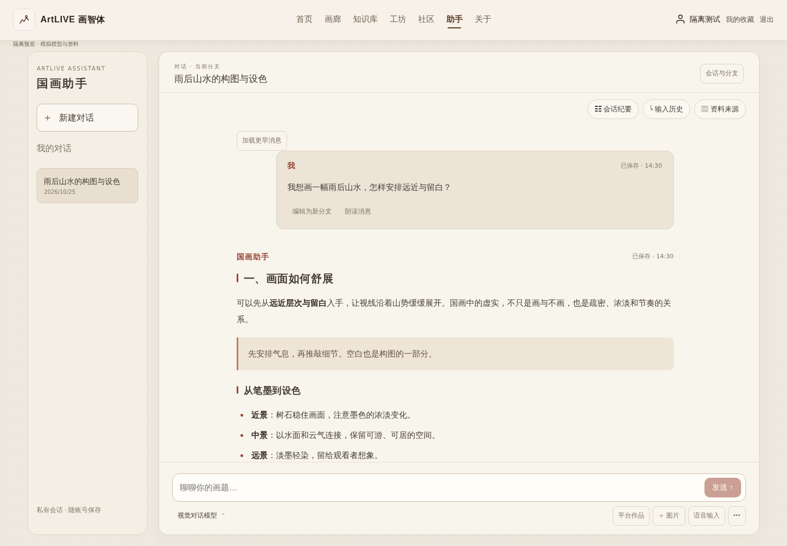

# 国画助手 UI 对齐：审查与浏览器证据

本次从 Web main `d5486df5924fa3f074b03e7106bc7322f9b763b1` 建立独立分支。开始时 release 仍为 `06311e2a93fbd634fc8a41f10ec66ffe998b9f90`，两者源码树一致。只修改助手前端，不改变 API、认证、服务端持久化或提供商配置。

## 已实现

- 原 ArtLIVE 导航下的纸色工作区：紧凑会话栏、独立消息滚动、底部常驻且可展开的输入框。大段介绍仅在空会话中出现。样式限于助手路由。
- 会话与分支管理、导出、存储用量、创作分类和执行恢复放入二级控件。原编辑操作仍创建新分支，不覆盖历史；没有整批清空历史入口。
- 会话纪要、输入历史、资料来源三种抽屉。打开仅 GET 读取，不触发模型或摘要生成。自动摘要仍按会话主动开启，原服务端阈值不变。
- 输入历史来自当前分支消息页中的 `USER` 记录，显示“已载入”数量并提供更早记录分页。来源按消息 `runId` 读取，核对执行与消息会话身份；保留服务端 provenance、文字快照、投递证据和版本。
- `react-markdown` / `remark-gfm` 显示回复与纪要。跳过原始 HTML，Markdown 图片替换为说明文字，不发起图片请求；只允许明确 HTTP(S) 外链，正文编号不会变成可信引用。服务端选择卡仍独立呈现。
- 模型菜单取自现有注册表，禁用未配置/停用/不支持流式的项目。作品筛选、私有图片、语音、朗读、取消和恢复均可访问；语音转写进入输入框后可编辑，不自动发送。未启用 RAGFlow。
- 原生模态抽屉与模型菜单支持键盘、Escape、焦点约束/返回；模型方向键只移动焦点，Enter 选择模型不会提交消息。适配 390px 与独立变化的 VisualViewport。

## 五张参考图与实际截图

已读取 `Picture.zip` 全部五图，以及原前端 `public/index.html`、`public/styles.css`、`public/app.js`。未引入原 archive 的 `.env`、SQLite、server 或匿名 localStorage 会话逻辑。

| 状态 | 参考文件 | 桌面实图 | 390px 实图 |
| --- | --- | --- | --- |
| 对话 | `24bc0ad9592f3256c97fbbc5a08ac36e.png` | [对话](conversation-desktop.png) | [对话](conversation-mobile.png) |
| 会话纪要 | `913cfbb08e2d5058f5c6922e313a37ed.png` | [纪要](summary-desktop.png) | [纪要](summary-mobile.png) |
| 输入历史 | `c91dc813e097701657f7f620a7326dad.jpg` | [输入历史](input-history-desktop.png) | [输入历史](input-history-mobile.png) |
| 来源 | `75c2b1287e52b410578d56bed4a227f1.jpg` | [来源](sources-desktop.png) | [来源](sources-mobile.png) |
| 模型菜单 | `b766b5a8778a0511e8f1479257b81ee2.jpg` | [模型](model-picker-desktop.png) | [模型](model-picker-mobile.png) |



补充：[手机会话导航](sessions-mobile.png)、[VisualViewport 440px 与展开输入/附件](keyboard-visual-viewport.png)、[流式回复](streaming.png)。截图是实际 Next 生产构建渲染，所有记录和模型均为隔离 fixture。截图文件摘要、构建身份和逐场景结果见 [evidence.json](evidence.json)。

## 验证结果

- `npm run typecheck`、`npm run lint`、`npm run build`：通过。
- `npm test`：163 tests、0 failed、0 skipped。
- `python3 tests/deploy-workflow-fixtures.py --bash bash`：15 fixtures 通过（本地 shell 验证，不进行部署）。
- Chromium 145.0.7632.6，17 个真实页面隔离场景全部 PASS，0 页面运行异常，0 未预期外网请求。
- 覆盖五态桌面/手机、长对话、多行输入、图片上传与刷新恢复、分页与分页失败、历史分支、源执行身份不一致、Markdown 注入/外链图片、服务端选择卡、流式/取消/刷新、不确定提交解析、账号切换、语音编辑、平台作品选择、历史模式、服务不可用、空会话及离开助手后的其他路由样式。
- 显式模拟的 404/503/丢失响应属于故障场景。正常场景没有控制台错误；故障响应与浏览器控制台记录保留在 evidence.json。
- 额外键盘检查曾发现：VisualViewport 缩小但 CSS 布局视口不变时，底部工具被遮挡。修正基于实际可视高度的紧凑布局后，440px 可视高度下发送和工具按钮均可见。原失败证据保留在项目 stage，不覆盖。
- 原提交、取消、明确重试、选择卡执行、编辑分支、摘要生成、分类动作实现保持不变；原幂等键、账户世代隔离、私有附件恢复与 UNKNOWN 处理继续生效。没有修改 Core 或 AI。

## 复现隔离浏览器检查

在本 worktree 安装依赖并构建，只使用回环地址：

```bash
npm ci
NEXT_PUBLIC_API_BASE_URL=http://127.0.0.1:4330 NEXT_PUBLIC_ASSISTANT_SIMULATED=true npm run build
npm run start -- --hostname 127.0.0.1 --port 4329
```

另一个终端运行（`PLAYWRIGHT_MODULE` 指向已安装的 Playwright 模块；未设置时从当前 Node 环境解析 `playwright`）：

```bash
ASSISTANT_WEB_URL=http://127.0.0.1:4329 \
ASSISTANT_API_URL=http://127.0.0.1:4330 \
ASSISTANT_BROWSER_OUTPUT=/tmp/artlive-assistant-ui-evidence \
npm run test:assistant-ui
```

4330 无需运行后端。浏览器拦截全部 API 并维护独立 fixture 状态；额外外网请求被拒绝。共用 shell 的微信脚本以空 fixture 替代。不要用生产 API 或真实登录凭据运行该测试。`next start` 在仓库现有 standalone 配置下会打印提示，本次回环验证确认实际 build manifest 及浏览器包一致；不作为生产部署入口。

## 与参考的差异及验收边界

- 保留 ArtLIVE 品牌/导航、当前会话标题和分支管理，因此顶部结构不是 demo 的逐像素复刻。参考颜色、字体栈、圆角、纸面、红色强调和右侧面板已对齐。
- 模型名称/数量来自实际注册表；截图使用明确标记的隔离模型，不照搬 demo 的提供商清单。来源显示完整 provenance 说明，输入历史只显示载入数量，不伪造 demo 中的总数。
- 自动摘要与 destructive 编辑/清空行为不照搬 demo。实际内容不同、系统中文字体不同也会产生排版差异。
- 已测试桌面 Chromium 和手机尺寸/VisualViewport 模拟；未声称真机 Safari、系统软键盘或真实麦克风端到端验收。本次没有付费模型或生产业务调用，亦不替代已完成的音乐验收。

## 发布边界与回退

只提交 feature → main 的审查 PR。本次没有 release 晋级或生产部署。以后若授权发布，仅 Web 前端包需要更新；无数据库、Core、AI 或模型变更。出现 UI 回归可按正常 PR 流程回退这次前端提交，不删除会话、历史分支、附件或执行记录。
