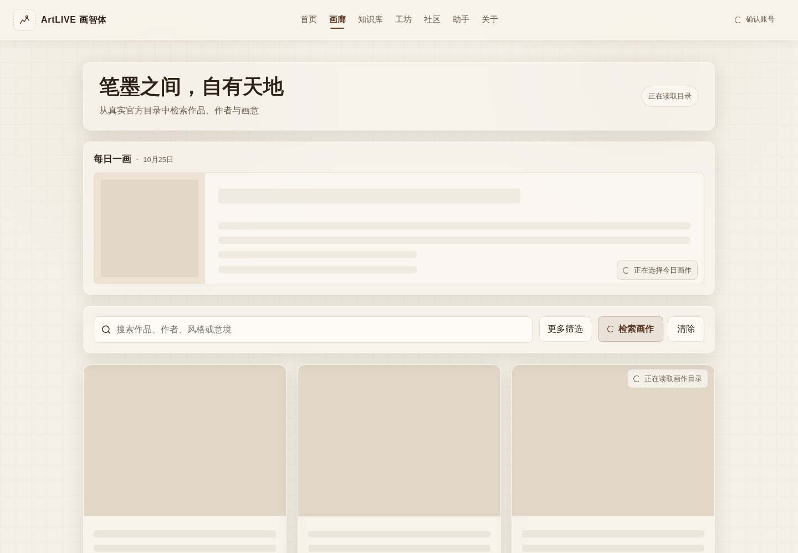
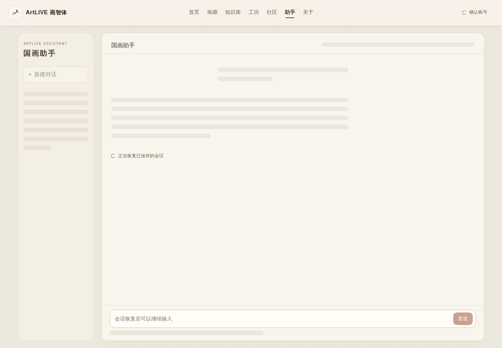

# 加载体验验证与图册

基线：main `923e5b66cb24c4eabc725cd67d7608b3e51c7827`；已接受的助手 release `cb4af4c7f7f27e35408efd908a9688e28a963d0c` 与该 main 源码树相同。未改依赖/锁文件、工作流或后端合同。

本目录只收录隔离的真实 Chromium 渲染截图。账号、画作、计数、消息和媒体均为合成夹具；**不是生产业务验收或网络性能测量**。无生产凭据、个人历史和付费调用。完整初始失败与复验记录保存在 migration stage `frontend-loading-experience-20261025T184131`，不改写旧失败。

## 重现

```bash
npm ci
npm run typecheck
npm test
npm run lint
python3 tests/deploy-workflow-fixtures.py --bash bash
NEXT_PUBLIC_API_BASE_URL=http://127.0.0.1:4350 NEXT_PUBLIC_ASSISTANT_SIMULATED=true npm run build
npm run start -- --hostname 127.0.0.1 --port 4349
```

另一个终端（需要可用的 Playwright；可通过 `PLAYWRIGHT_MODULE` 指向既有安装，不修改项目依赖）：

```bash
LOADING_WEB_URL=http://127.0.0.1:4349 \
LOADING_API_URL=http://127.0.0.1:4350 \
LOADING_BROWSER_OUTPUT=/tmp/artlive-loading-evidence \
node tests/loading-experience.browser.mjs
```

4350 无需真实服务：所有 API 由浏览器 route 拦截；未知 API 使测试失败，所有外部请求被禁止。运行前确认预览端口没有其他进程，测试会比对 `.next/BUILD_ID`，不能拿旧服务验证新代码。`LOADING_CASES` 支持逗号分隔的定向复验；原助手/工坊脚本也支持 `ASSISTANT_CASES` / `STUDIO_CASES`。

## 验证范围

- 五页 1440×1000 与 390×844：初始化、数据就绪、导航、页面水平溢出、减弱动画、profile 读取计数、图片容器尺寸。
- 每日推荐慢于目录；快速两次查询的乱序返回；分页控件保留；不同查询不展示旧页为新结果。
- 收藏分区失败/重试与翻页；忽略 AbortSignal 的旧账号响应不能覆盖新账号。
- 工坊流程列表失败不遮蔽可用编辑器和历史；保留未提交草稿；403 清空旧作品。
- 知识库图谱失败/重试、键盘选项卡、返回已读页不重复请求；实际 ECharts canvas 渲染。
- 助手刷新保留草稿、滚动、已加载更早消息；来源/抽屉保持已有记录；模型核验失败不授权发送；存储用量403清空旧值。
- 长时认证恢复及登录过期；详情和延迟图片；快速跨路由导航；原助手/工坊状态机、附件、流式取消、UNKNOWN、源切换回归复用并定向复核变化。

## 边界与保留问题

本次未做生产部署、真实网络测速、付费模型、真机 Safari 或麦克风验收；不把模拟浏览器通过扩展为这些结论。原已接受助手的模型长说明内部溢出、历史 watchdog 退出原因继续是独立 follow-up。图片缩略图/载荷压缩没有现成后端合同，此次不宣称降低图片字节或生产 LCP。

参见 [默认组件与未来页面规则](../FRONTEND_LOADING.md)。后续发布仅走原 Web 审查/晋级/环境规则，本 PR 不触发生产部署，不涉及 Core、AI、数据库或 VMM。

## 实际结果

- `npm ci`、typecheck、lint、生产构建：PASS；163 单元测试、15 部署 shell fixtures：PASS。
- 新加载浏览器场景：**21/21 PASS**；助手：**17/17 PASS**；工坊：**41/41 PASS**，复用不受后续变更影响的已通过场景并定向复核失败及变化。详细来源见 [RESULT.json](RESULT.json)。
- 无 pageerror、无生产/付费请求。所有读取夹具均显式匹配；初期文案/隐藏 Suspense 节点/路径断言失败保留在 stage，不伪装成应用通过记录。
- 画廊桌面和手机 loading→ready 的标题、筛选区与每日图容器坐标/尺寸一致（桌面图片200px、手机132px）；所有五页无页面水平溢出。此为夹具内布局量测，不是生产 CLS/LCP 或速度提升数据。
- 人工截图检查发现并去除了旧整页透明淡入的首帧空白；长列表的状态/慢读重试保持首屏可见；手机推荐占位行数贴合实际132px容器。
- 无新增已知阻断问题；上文列明的真实设备、生产性能与独立旧 follow-up 未扩展为 PASS。

## 五页桌面与 390px 图册

| 页面 | 桌面读取中 | 桌面完成 | 390px读取中 | 390px完成 |
| --- | --- | --- | --- | --- |
|画廊|[查看](screenshots/desktop-gallery-loading.png)|[查看](screenshots/desktop-gallery-ready.png)|[查看](screenshots/mobile-gallery-loading.png)|[查看](screenshots/mobile-gallery-ready.png)|
|知识库|[查看](screenshots/desktop-knowledge-loading.png)|[查看](screenshots/desktop-knowledge-ready.png)|[查看](screenshots/mobile-knowledge-loading.png)|[查看](screenshots/mobile-knowledge-ready.png)|
|工坊|[查看](screenshots/desktop-studio-loading.png)|[查看](screenshots/desktop-studio-ready.png)|[查看](screenshots/mobile-studio-loading.png)|[查看](screenshots/mobile-studio-ready.png)|
|助手|[查看](screenshots/desktop-assistant-loading.png)|[查看](screenshots/desktop-assistant-ready.png)|[查看](screenshots/mobile-assistant-loading.png)|[查看](screenshots/mobile-assistant-ready.png)|
|个人页|[查看](screenshots/desktop-me-loading.png)|[查看](screenshots/desktop-me-ready.png)|[查看](screenshots/mobile-me-loading.png)|[查看](screenshots/mobile-me-ready.png)|





## 额外状态

- [profile-independent-failure-retry-account-partial-error.png](screenshots/profile-independent-failure-retry-account-partial-error.png)
- [studio-list-failure-keeps-editor-and-results-partial-failure.png](screenshots/studio-list-failure-keeps-editor-and-results-partial-failure.png)
- [assistant-capability-read-failure-never-authorizes-model-unverified.png](screenshots/assistant-capability-read-failure-never-authorizes-model-unverified.png)
- [assistant-storage-permission-clears-retained-usage-forbidden-usage.png](screenshots/assistant-storage-permission-clears-retained-usage-forbidden-usage.png)
- [detail-and-image-loading-detail-skeleton.png](screenshots/detail-and-image-loading-detail-skeleton.png)
- [gallery-independent-query-race-pagination.png](screenshots/gallery-independent-query-race-pagination.png)
- [assistant-refresh-draft-scroll-drawers-retained-history.png](screenshots/assistant-refresh-draft-scroll-drawers-retained-history.png)
